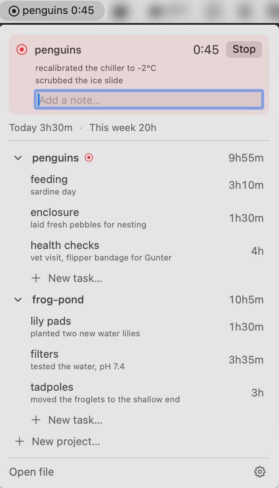
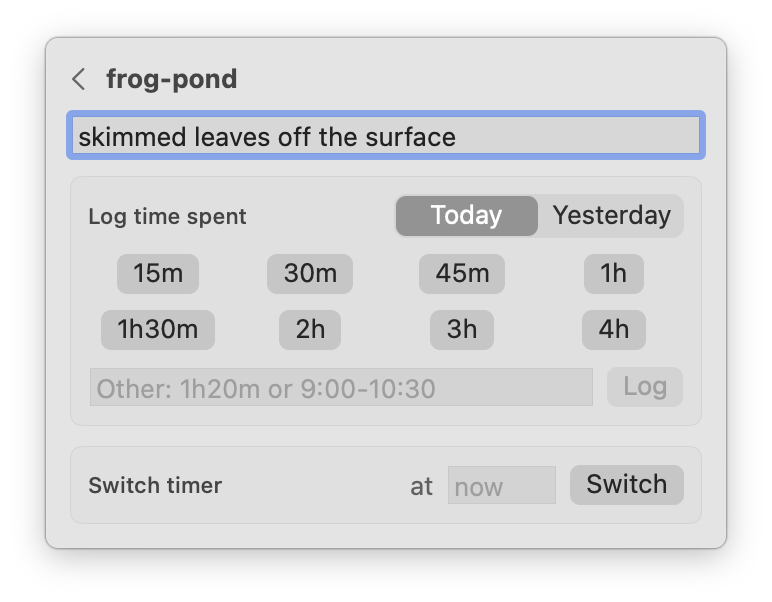

# klog-menu

A macOS menu bar front-end for the [klog](https://klog.jotaen.net) personal time tracker. It uses the klog CLI to make all the edits.

 

## Using it

- The menu bar shows today's total, or the running project (and task, if any) with
  its elapsed time.
- The ddropdown lists every project, most recently used first, with this week's
  totals.
- While a timer runs, the dropdown shows an "Add a note…" field.
  Each note you enter becomes a new line of the running entry's summary, like the
  two lines under `#penguins` above.
- Click a project name to log time or start a timer on the project with no task.
  Click a task to do the same for that task. Time without a task only shows in the
  project's total, not as a row of its own.
- personally I don't actually use tasks much, I just use projects and description lines, and it's great at that, but if you use tasks
  it is also great at that!
- The gear menu changes the file (default is my own file path `~/timetrack/time.klg` which is my own path and probably not what you want )  
- Changes made elsewhere (an editor, the klog CLI, another front-end) show up within 15 seconds
  
## Requirements

- macOS 14 or later
- The `klog` CLI. The app looks for it in `~/bin`, `/opt/homebrew/bin`,
  `/usr/local/bin` and `~/go/bin`, in that order (apps launched from Finder don't
  see your shell's `PATH`).
- Xcode, to build. Command Line Tools alone lack the SwiftUI macro plugin.

## Build and install

```bash
./build.sh
```

This builds with Xcode's toolchain, installs `~/Applications/KlogMenu.app`, and
launches it. Build products go to `~/Library/Caches/klog-menu-build`. Run the tests with:

```bash
DEVELOPER_DIR=/Applications/Xcode.app/Contents/Developer swift test --scratch-path ~/Library/Caches/klog-menu-build
```

## File format

Go read about [klog's file format](https://klog.jotaen.net/#file-format). It uses klog. It's great.

```
2026-10-16
    8:30 - 9:10 sardine day #penguins=feeding
    13:00 - 13:45 planted two new water lilies #frog-pond="lily pads"
    30m ordered more krill #penguins
    17:02 - ? #penguins
        recalibrated the chiller to -2°C
        scrubbed the ice slide
```


### How notes are written

klog has no released command for adding to a running entry. At launch the app
checks whether the installed klog has a `note` command (from the `note-command`
branch of [dmd/klog](https://github.com/dmd/klog/tree/note-command)). If so, notes go
through `klog note --date=<day>`. Otherwise the app inserts the line itself, then
checks with `klog json` that the file still parses and puts the original back if
not. Hopefully my new `note` command will be merged  and I can simplify this.
